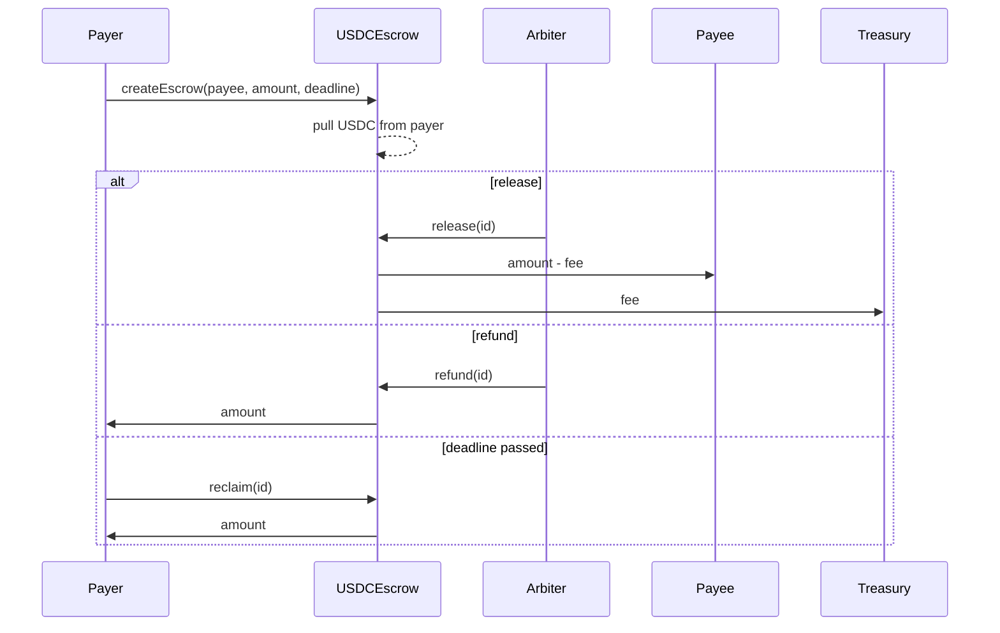

# USDCEscrow Design Doc

## 1. Metadata

- Status: Draft (awaiting your confirmation)
- Target chain: Arc Testnet (chain ID 5042002), USDC ERC-20 at `0x3600000000000000000000000000000000000000` (6 decimals)
- Language: Solidity 0.8.28, Foundry, OpenZeppelin 5.x
- Reviews: [ ] Design  [ ] Security (thorough review + static analysis + unit tests before deploy)

## 2. Action Items (living)

- Open: you must provide the admin, treasury, and initial arbiter addresses before deploy. None are guessed.

## 3. Goals / Non-Goals

Goals
- A payer locks USDC for a payee. A single global arbiter decides: release to the payee (minus fee) or refund to the payer.
- If nobody acts, the payer can reclaim after a per-escrow deadline.
- Admin can pause creation of new escrows only. Existing escrows can always be released, refunded, or reclaimed.
- Immutable: no proxy, no upgrade path, no way for the admin to touch escrowed funds.

Non-Goals
- Partial releases, milestones, disputes with evidence, multiple arbiters, non-USDC tokens, native-value deposits, gasless/signature flows.

## 4. Requirements

Functional
- F1 Payer creates an escrow with payee, amount, deadline. Funds move payer to contract.
- F2 Arbiter releases: payee receives amount minus fee, treasury receives fee.
- F3 Arbiter refunds: payer receives the full amount, no fee.
- F4 Payer reclaims the full amount at or after the deadline if still open.
- F5 Admin sets the arbiter, pauses and unpauses creation. Admin transfer is two-step.

Security (testable assertions)
- S1 Each escrow settles exactly once (Funded to Released, Refunded, or Reclaimed, never back).
- S2 Only the arbiter can release or refund. Only the payer can reclaim, and only after the deadline.
- S3 Payer cannot release to the payee directly.
- S4 Admin has no function that moves escrowed USDC.
- S5 Pause never blocks release, refund, or reclaim.
- S6 Contract USDC balance is always >= sum of open escrow amounts.
- S7 Fee is at most `MAX_FEE_BPS` and cannot change after deploy.
- S8 Arbiter cannot settle an escrow in which it is the payer or payee.

## 5. Terminology & Actors

| Actor | Trust | Powers |
| --- | --- | --- |
| Payer | Untrusted | Create escrow, reclaim after deadline |
| Payee | Untrusted | Receives funds on release. No on-chain actions |
| Arbiter | Semi-trusted (global) | Release or refund any open escrow |
| Admin (owner) | Semi-trusted | Set arbiter, pause or unpause creation, two-step ownership transfer |
| Treasury | Passive | Receives fees |

## 6. Language / Runtime

Solidity 0.8.28 (checked arithmetic), `evm_version` as set in `foundry.toml`. Built on OpenZeppelin `Ownable2Step`, `Pausable`, `ReentrancyGuard`, `SafeERC20`. No custom assembly.

## 7. Transaction & Execution Model

All state is committed atomically. Every function that moves USDC follows checks, effects (status set to a terminal state), then interactions, and is also `nonReentrant`. USDC is not a callback token, so reentrancy risk is low, but the guard is cheap defence in depth.

## 8. Chain Standards & Interfaces

ERC-20 (USDC) only, via `SafeERC20`. On Arc, USDC is also the native gas token: this contract uses only the 6-decimal ERC-20 view, never `msg.value`, and rejects native transfers (no `receive` or `fallback`).

## 9. Architecture Overview

Flow of funds

| Step | Movement | Invariant |
| --- | --- | --- |
| create | payer to contract, `amount` (balance-delta checked) | contract balance rises by exactly `amount` |
| release | contract to payee (`amount - fee`) and treasury (`fee`) | sum out equals `amount` |
| refund | contract to payer, `amount` | sum out equals `amount` |
| reclaim | contract to payer, `amount` | only after deadline |

Resting-state invariant: contract balance equals the sum of open escrow amounts (plus any USDC sent directly by mistake, which is not recoverable by design, see section 17).

Dependencies: USDC token at the constructor-supplied address. Assumes USDC is a standard, non fee-on-transfer token. A balance-delta check enforces this at creation.

## 10. Contract Design

Roles

| Role | Holder | Permissions | Why |
| --- | --- | --- | --- |
| Owner | Admin address you provide, Ownable2Step | `setArbiter`, `pause`, `unpause` | Minimal operational control |
| Arbiter | Address set by owner | `release`, `refund` | Dispute resolution |
| Payer (per escrow) | Creator | `reclaim` after deadline | Liveness guarantee |

Storage

- Immutables: `usdc` (IERC20), `treasury` (address), `feeBps` (uint16)
- Constants: `MAX_FEE_BPS = 500`, `MIN_DURATION = 1 hours`, `MAX_DURATION = 365 days`, `BPS = 10_000`
- `address arbiter`
- `uint256 nextId`
- `mapping(uint256 => Escrow) escrows`
- `struct Escrow { address payer; address payee; uint96 amount; uint64 deadline; Status status; }`
- `enum Status { None, Funded, Released, Refunded, Reclaimed }`

Writes

| Function | Caller | State change | Event | Reverts |
| --- | --- | --- | --- | --- |
| `createEscrow(payee, amount, deadline) returns (id)` | anyone | new Funded escrow, pulls USDC | `EscrowCreated` | paused, zero payee, payee == payer, zero amount, amount over uint96, deadline outside [now + MIN_DURATION, now + MAX_DURATION], balance-delta mismatch |
| `release(id)` | arbiter | Funded to Released, pays payee and treasury | `EscrowReleased` | not arbiter, not Funded, arbiter is payer or payee |
| `refund(id)` | arbiter | Funded to Refunded, pays payer | `EscrowRefunded` | not arbiter, not Funded, arbiter is payer or payee |
| `reclaim(id)` | payer | Funded to Reclaimed, pays payer | `EscrowReclaimed` | not payer, not Funded, before deadline |
| `setArbiter(addr)` | owner | updates arbiter | `ArbiterUpdated` | zero address |
| `pause()` / `unpause()` | owner | toggles creation only | `Paused` / `Unpaused` | OZ standard |

Reads: `getEscrow(id)`, `arbiter()`, `feeBps()`, `treasury()`, `usdc()`, `previewFee(amount)`.

Fee: `fee = amount * feeBps / BPS`, rounded down, charged on release only. Payee receives `amount - fee`.

Constructor: `(usdc, owner, arbiter, treasury, feeBps)`. Rejects zero addresses and `feeBps > MAX_FEE_BPS`. Fee is proposed at 100 bps (1%) unless you choose otherwise.

## 11. Deployment & Initialization

Plain constructor, no initializer. Genesis: owner = your admin address, arbiter = your chosen arbiter, treasury = your treasury address. Nothing is left in the contract after deploy.

## 12. Upgradeability

None. Migration story: deploy a new version, pause creation on the old one, let open escrows settle, point integrators at the new address.

## 13. Key Management

Owner and arbiter should be separate keys. Owner uses Ownable2Step (no `renounceOwnership`, overridden to revert). No signatures, no off-chain authorisation.

## 14. Security Considerations

| Vulnerability | Applicable? | Mitigation |
| --- | --- | --- |
| Reentrancy | Low | CEI plus `nonReentrant` |
| Access control | Yes | Role checks on every privileged function, see roles table |
| Overflow | Checked | `amount` bounded to uint96, no `unchecked` |
| Unchecked external call | Yes | `SafeERC20` |
| Fee-on-transfer | Yes | balance-delta check at creation |
| Signature replay | N/A | no signatures |
| Front-running | Low | arbiter is global, no price. Payer reclaim vs arbiter settle is first-come, either outcome is valid |
| Oracle / flash loan | N/A | none used |
| DoS | Yes | no loops, no push-to-many, each escrow independent |
| Delegatecall / proxy | N/A | immutable |
| Timestamp | Yes | deadline tolerance is minutes, not used for randomness |
| Approval persistence | Yes | payer approves exact amount, contract never holds allowances |
| Centralisation | Yes | see section 15 |
| USDC blocklist | Yes | if payee is blocked, release reverts: arbiter refunds or payer reclaims. If payer is blocked, refund and reclaim revert: arbiter releases. Treasury blocked blocks release: arbiter refunds |
| Stuck funds | Yes | every open escrow has a payer-only exit after the deadline |

## 15. Trust Model & Threat Analysis

| Actor | Worst case if compromised | Mitigation | Detection |
| --- | --- | --- | --- |
| Arbiter key | Can send any open escrow to its payee or back to its payer. Cannot redirect funds elsewhere | Keep arbiter separate from admin, use a multisig in production | `EscrowReleased` and `EscrowRefunded` monitoring |
| Owner key | Can replace the arbiter with a malicious one (affects open escrows), or pause creation. Cannot withdraw funds | Two-step transfer, multisig in production | `ArbiterUpdated` alert |
| Treasury | None (passive) | Fixed at deploy | n/a |

Known tradeoff: a global arbiter means an arbiter swap applies to open escrows. Chosen per your decision.

## 16. Failure Scenarios

- Arbiter key lost: no releases or refunds. Every payer reclaims after its deadline. Owner can set a new arbiter.
- USDC transfer reverts (blocklist): whole call reverts, status unchanged, another exit remains available.
- Pause active: creation reverts, all settlement paths still work.

## 17. Emergency Response

Pause stops new escrows only. No rescue function: tokens sent directly to the contract are not recoverable. This avoids any admin path to escrowed funds (S4) and is stated here as an accepted limitation.

## 18. Priorities & Tradeoffs

| Decision | Rationale | Rejected |
| --- | --- | --- |
| Global arbiter | Your choice, simple | Per-escrow arbiter (more flexible, more surface) |
| Immutable fee and treasury | Removes an admin lever | Adjustable fee |
| Pause creation only | Funds are never trapped by admin | Full pause |
| No rescue function | No admin path to funds | Rescuer role |
| Arbiter cannot settle own escrow | Prevents self-dealing | Trusting the arbiter |

## 19. Testing Strategy

Foundry. Happy paths, every revert path, events, access control for each role, deadline boundaries (deadline minus 1 second and at deadline), fee rounding fuzz, double-settle attempts, pause behaviour, constructor validation, malicious or fee-on-transfer token mock, and an invariant test that contract balance equals the sum of open escrows. Static analysis plus a thorough review before deploy. Run: `forge test`.

## 20. Third-party libraries

OpenZeppelin Contracts (already installed): `Ownable2Step`, `Pausable`, `ReentrancyGuard`, `SafeERC20`. Widely audited.

## 21. Monitoring

Alert on `ArbiterUpdated`, `Paused`, ownership transfer events, and large `EscrowReleased` amounts.

## 22. Worked Example

Payer approves 100 USDC, calls `createEscrow(payee, 100e6, now + 7 days)`. Arbiter calls `release(id)`: payee gets 99 USDC, treasury gets 1 USDC at 100 bps. If the arbiter never acts, the payer calls `reclaim(id)` after day 7 and gets 100 USDC back.
